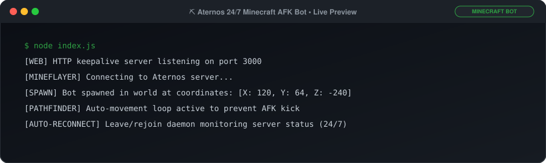

<h1 align="center">⛏️ Aternos 24/7 Minecraft AFK Bot</h1>

<p align="center">
  <a href="https://github.com/itzxsahil">
    
  </a>
</p>

<p align="center">
    
</p>

---

## 📸 Project Preview

<p align="center">
  
</p>

---

# 🚀 Overview

A robust, automated AFK client for Minecraft and Aternos servers built with **Mineflayer**. Features automated anti-AFK pathfinding, auto-reconnect on server restart, and an embedded web keepalive server for 24/7 cloud hosts.

---

# 🏗️ System Architecture & Data Flow

<p align="center">
  
</p>

<br>

The Node.js Mineflayer client connects to the Minecraft server protocol, executing randomized micro-movements with the Pathfinder library while Express handles HTTP keepalive probes.

---

# ✨ Features

✅ **Auto Leave & Rejoin**: Detects restarts and kicks to reconnect automatically.\n✅ **Anti-AFK Movement**: Randomized jumping, walking, and looking via `mineflayer-pathfinder`.\n✅ **HTTP Keepalive Server**: Embedded web server prevents free cloud hosts from sleeping.\n✅ **Customizable Config**: Server IP, port, and bot username configured via `settings.json`.

---

# 📦 Installation & Quickstart

```bash
git clone https://github.com/itzxsahil/aternos-bot.git
cd aternos-bot
npm install
# Edit server IP and port in settings.json
npm start
```

---

# 👤 Author & Support
- Built with ❤️ by [@itzxsahil](https://github.com/itzxsahil)
- Star ⭐ this repository if you find it helpful!
